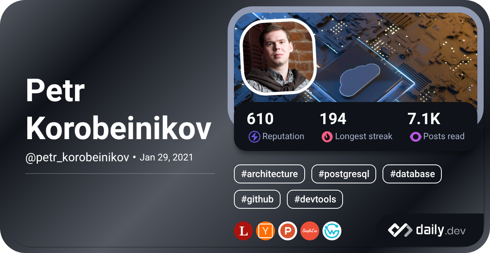

## Petr Korobeinikov 👨‍💻

I am Founding Engineer & Architect ~~building a cloud at [#CloudMTS](https://cloud.mts.ru/)~~ seeking a Principal Engineer role.

🌐 [petr-korobeinikov.com](https://petr-korobeinikov.com/) · [Blog](https://petr-korobeinikov.com/posts/) · CV: [EN](https://petr-korobeinikov.com/cv/) / [RU](https://petr-korobeinikov.com/ru/cv/)

### 🛠 Tech Stack

**Languages** 

**Backend** 

**Data & Messaging** 

**Cloud Native** 

### 🧩 Open Source

- **PostgreSQL 9.6**: [`\ev` and `\sv` psql commands](https://git.postgresql.org/pg/commitdiff/8eb6407aaeb6cbd972839e356b436bb698f51cff) for editing and showing view definitions
- **PostgreSQL 9.6**: [`to_reg*()` functions accept `text`](https://git.postgresql.org/pg/commitdiff/ea0d494dae0d3d6fce26bf5d6fbaa07e2ee6c402) instead of `cstring`
- **gci**: [`localmodule` support for projects without Go sources in the root](https://github.com/daixiang0/gci/pull/192), shipped with golangci-lint
- Smaller fixes: [http-timeout](https://github.com/wreulicke/http-timeout/pull/1), [asdf-eza](https://github.com/lwiechec/asdf-eza/pull/6)

### 📝 Publications

On [Habr](https://habr.com/ru/users/petr-korobeinikov), in Russian.

- [GraphQL и Go — gqlgen после года в проде: опыт, советы и выводы](https://habr.com/ru/companies/ru_mts/articles/994594/) 2026-02-16 · MTS
- [Создаем типовое локальное окружение для разработчика](https://habr.com/ru/companies/mws/articles/735350/) 2023-05-30 · MTS / #CloudMTS
- [Несколько мыслей по подготовке к алгоритмической части собеседования](https://habr.com/ru/companies/mws/articles/735348/) 2023-05-17 · MTS / #CloudMTS
- [Как мы сделали для разработчиков универсальную шину событий, не требующую знаний Kafka и прочих брокеров](https://habr.com/ru/companies/mws/articles/721964/) 2023-03-14 · MTS / #CloudMTS

Earlier: Avito, 2017

- [Встречаем PostgreSQL 10. Перевод Release Notes](https://habr.com/ru/companies/avito/articles/339520/) 2017-10-09 · Avito
- [Чемпионат #PGHACK. Платформа](https://habr.com/ru/companies/avito/articles/336246/) 2017-08-29 · Avito
- [PGHACK. Соревнование в офисе Avito 2 сентября](https://habr.com/ru/companies/avito/articles/334886/) 2017-08-07 · Avito

---

